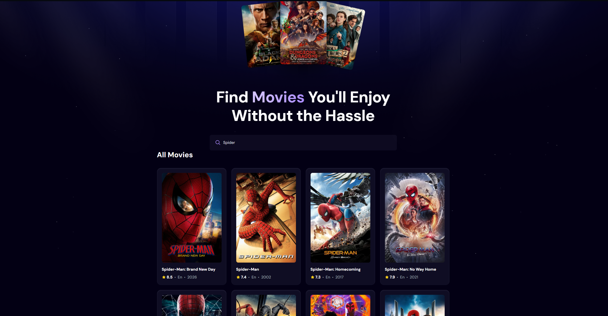

# Movie Library — Web

A React app for discovering movies: search the TMDB catalogue with debounced live search, and see what's trending based on what users search for most.



## Features
- **Live search** with 500 ms debounce to avoid firing a request on every keystroke
- **Popular movies** by default, switching to search results as you type
- **Trending section** ranked by search count, tracked whenever a search returns results
- Loading and error states for every data fetch

## Tech stack
React 19 · Vite · Tailwind CSS 4 · TMDB API · Appwrite (search-count storage)

## Running locally
```bash
git clone https://github.com/tarek-metwally-coder/movie-library-web.git
cd movie-library-web
npm install
cp .env.example .env.local  # then fill in your keys
npm run dev
```

### Environment variables
| Variable | Purpose |
|---|---|
| `VITE_TMDB_API_KEY` | TMDB API read access token |
| `VITE_APPWRITE_PROJECT_ID` | Appwrite project |
| `VITE_APPWRITE_DATABASE_ID` | Appwrite database |
| `VITE_APPWRITE_COLLECTION_ID` | Collection storing search counts |

## Roadmap
- [ ] Replace Appwrite with a custom **ASP.NET Core API** (vertical-slice architecture, PostgreSQL)
- [ ] Proxy TMDB through the API so the key never reaches the browser
- [ ] Migrate the frontend to TypeScript
- [ ] Watchlists and user accounts