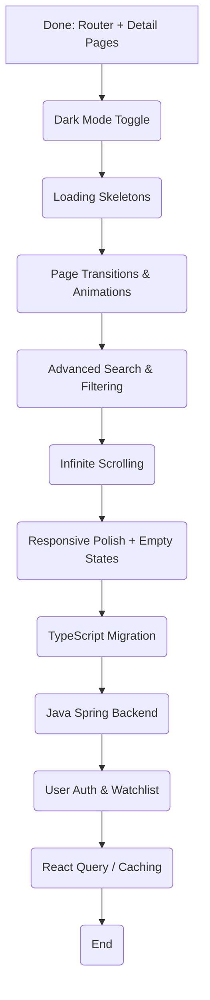

## Project Analysis: React Streaming App

### Current Architecture

The application is a client-side rendered (CSR) Single Page Application (SPA) built with React and bundled using Vite. It functions as a movie browsing, search, and detail platform.

**Key Architectural Components:**

*   **Frontend (React/Vite):**
    *   **Entry Point:** `main.jsx` initializes the React application with React Router (`BrowserRouter`), rendering the root `App` component.
    *   **Routing:** `App.jsx` defines two routes: `/` (HomePage) and `/movie/:id` (MovieDetail).
    *   **Component-Based UI:** Composed of reusable components: `Search`, `MovieCard`, `Spinner` for the home page; `MovieDetail` for rich movie detail views.
    *   **Data Fetching:**
        *   **TMDb API:** Direct `fetch` requests for movie searching, discovery, and detail data.
        *   **Appwrite Backend (optional/fallback):** For trending movies and search term tracking. Currently non-functional; mock data is used via `src/data/mockMovies.js`.
    *   **State Management:** Local component state with `useState` and `useEffect`.
    *   **Debouncing:** `useDebounce` from `react-use` on search input to limit API calls.
*   **Backend (Planned — Java Spring):**
    *   A Java Spring Boot backend will be built separately to replace Appwrite, providing persistent storage, user management, and a proper API layer for production use.

### Technologies Used

*   **Frontend Framework:** React 19 (with JSX)
*   **Build Tool:** Vite 7
*   **Routing:** React Router DOM v7
*   **Styling:** Tailwind CSS v4 (utility-first CSS framework)
*   **External APIs:** The Movie Database (TMDb) API (for movie data)
*   **Mock Data Layer:** `src/data/mockMovies.js` (active until backend is built)
*   **JavaScript Libraries:**
    *   `react-dom` — React rendering
    *   `react-use` — Useful React hooks (`useDebounce`)
    *   `appwrite` SDK — Backend as a Service (currently non-functional, being replaced)
*   **Development Tools:**
    *   ESLint — Code linting
    *   `@vitejs/plugin-react` — Vite plugin for React support
    *   `@tailwindcss/vite` — Vite plugin for Tailwind CSS

---

## Revamped Roadmap: Portfolio-Optimized Feature Ranking

This roadmap re-prioritizes features using the following criteria:
- **Recruiter Wow Factor** first, implementation effort second
- Features that are immediately visible in screenshots and demos
- Modern React patterns (hooks, composition, Framer Motion)
- No enterprise complexity unless it has clear portfolio value
- Realistic to complete in a weekend

### Prioritized Feature List

**1. ✅ React Router & Movie Detail Pages (DONE)**
- **Wow Factor:** High — demonstrates SPA navigation, dynamic routing, rich data display
- **Effort:** Done
- **Why:** Foundational for all other features. Shows understanding of modern SPA architecture.

**2. 🔺 Dark Mode Toggle (HIGH Priority — Low Effort, High Impact)**
- **Wow Factor:** Very High — instantly visible in before/after screenshots
- **Effort:** Low
- **Why:** Projects already uses a dark background; adding a light theme toggle is minimal CSS. Every recruiter recognizes this as a quality-of-life feature. Great for portfolio screenshots showing "theme switching capability."

**3. 🔺 Loading Skeletons (HIGH Priority — Low Effort, High Impact)**
- **Wow Factor:** High — immediately visible in screenshots during loading states
- **Effort:** Low
- **Why:** More impressive than a spinner. Shows attention to perceived performance and modern UX patterns. Easy to implement and photograph for a portfolio.

**4. 🔺 Page Transitions & Micro-interactions (HIGH Priority — Medium Effort, Very High Impact)**
- **Wow Factor:** Very High — the #1 visual differentiator between "tutorial project" and "real app"
- **Effort:** Medium (add Framer Motion)
- **Why:** Card hover effects, page transition animations, backdrop parallax, skeleton pulse animations. These are immediately visible in any demo or screen recording. Framer Motion is the industry standard for React animations.

**5. ➡️ Advanced Search & Filtering (MEDIUM Priority — Medium Effort)**
- **Wow Factor:** High
- **Effort:** Medium
- **Why:** Filtering by genre, year, rating directly enhances the core search experience. Interactive UI controls (dropdowns, sliders, chips) show UX thinking and data manipulation skills.

**6. ➡️ Infinite Scrolling / Pagination (MEDIUM Priority — Medium Effort)**
- **Wow Factor:** High
- **Effort:** Medium
- **Why:** Improves browsing for large movie lists. Demonstrates performance optimization, scroll handling, and data loading patterns.

**7. ➡️ Responsive Polish & Empty States (MEDIUM Priority — Medium Effort)**
- **Wow Factor:** Medium-High
- **Effort:** Medium
- **Why:** The #1 thing recruiters check is mobile responsiveness. Empty states (no search results, no watchlist items) show attention to UX edge cases. These details separate senior from junior work.

**8. 🔻 TypeScript Migration (MEDIUM Priority — Medium Effort)**
- **Wow Factor:** Medium (invisible in screenshots)
- **Effort:** Medium
- **Why:** Many mid-level+ roles filter by TypeScript experience. While not visually flashy, it's a strong signal on GitHub and in technical discussions. Demonstrates type safety awareness.

**9. 🔻 Java Spring Backend (FUTURE — High Effort, Very High Impact)**
- **Wow Factor:** Very High — full-stack capability
- **Effort:** High (separate project)
- **Why:** After the frontend is polished, building a Java Spring Boot backend replaces the Appwrite dependency, adds proper REST APIs, persistent storage, and user management. A full-stack project is significantly more impressive than frontend-only.

**10. 🔻 User Authentication & Watchlist (FUTURE — depends on backend)**
- **Wow Factor:** High
- **Effort:** High (requires backend)
- **Why:** Personalized experiences (saving favorites, watchlist) demonstrate full-stack capability. Wait until the Java Spring backend is built to implement this properly.

**11. 🔻 Caching Strategy with React Query (LOWER Priority — Medium Effort)**
- **Wow Factor:** Low (invisible)
- **Effort:** Medium
- **Why:** Internal optimization. Good for technical discussion but doesn't improve screenshots or demos. Defer until other visual features are complete.

**12. 🔻 PWA / Offline Support (LOWER Priority — Medium Effort)**
- **Wow Factor:** Low (hard to demonstrate)
- **Effort:** Medium
- **Why:** Service workers and offline support are nearly impossible to showcase in a demo or screenshot. For a movie app specifically, offline capability adds questionable UX value. Move to the bottom of the list.

### Features Explicitly De-prioritized

- **Centralized State Management (e.g., Zustand):** Invisible to users. The current `useState` pattern is sufficient until the app grows significantly. Doesn't improve portfolio screenshots.
- **Unit/Integration Tests:** High effort, zero visual impact. Important for production but a poor portfolio investment at this stage.
- **Refactor CSS with Tailwind Utilities:** Internal cleanup. No demo value.
- **Magic Strings / Error Handling Refactors:** Necessary for production but invisible in demos.

---

### Code Smells & Technical Debt (Acknowledge, Don't Fix Yet)

These are known issues that should be addressed before a production launch but are intentionally deferred to maximize portfolio-visibility feature work first:

- `App.jsx` as a God Component (partially fixed by extracting pages)
- Direct API calls in components (tight coupling; mitigated by mock data layer)
- Magic strings/numbers (hardcoded values)
- Repetitive error handling logic
- Lack of TypeScript (planned migration above)
- No testing

---

### Implementation Notes on Mock Data

Until the Java Spring backend is operational:
- `src/data/mockMovies.js` provides 8 detailed movies with full cast, crew, videos, and production data
- All API calls fall back to mock data on failure
- The detail page (`MovieDetail.jsx`) uses `getMockMovieById()` when the TMDb API returns an error
- Search queries will show error state since TMDB API key may be missing
